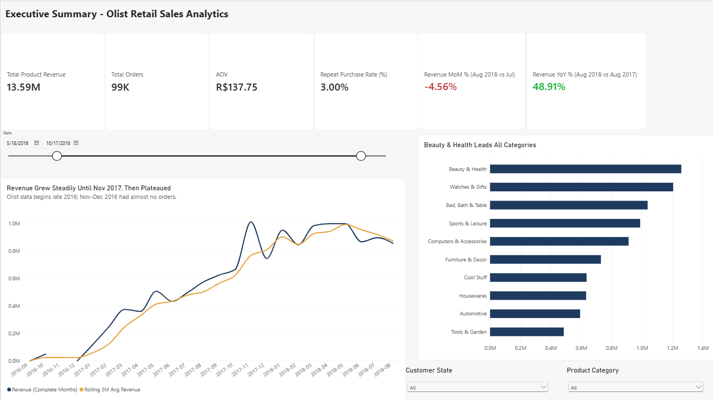
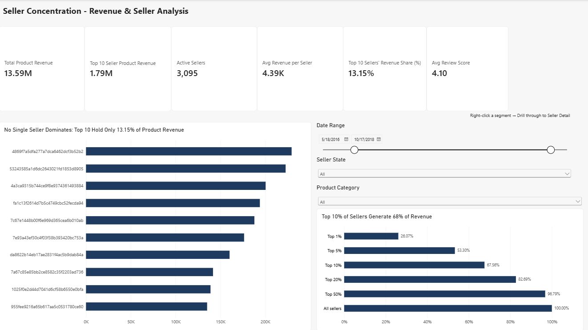
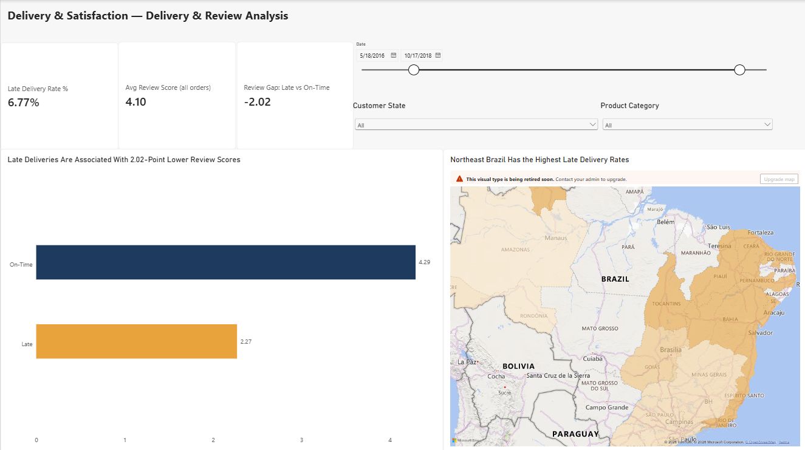
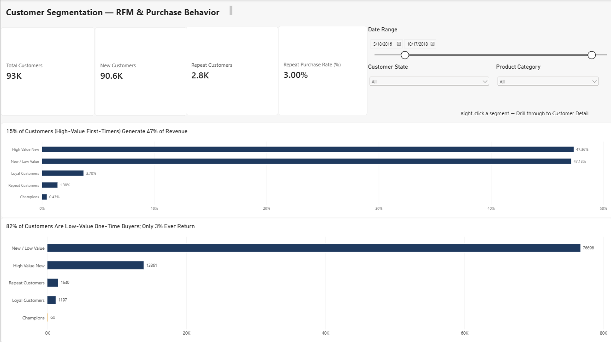
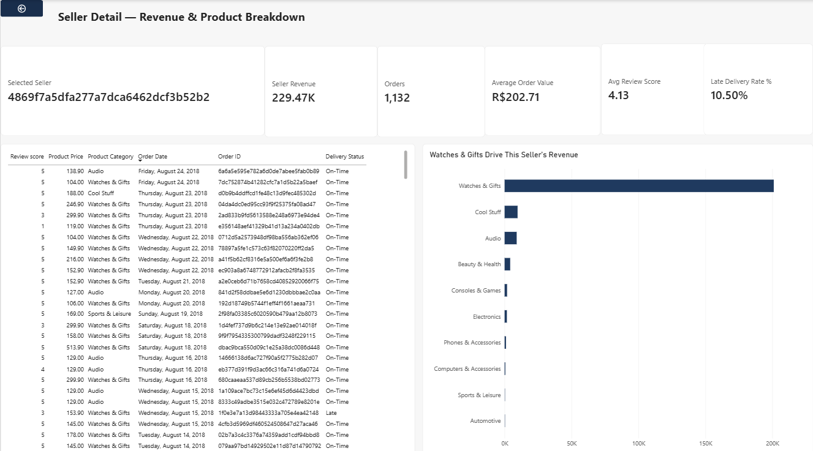
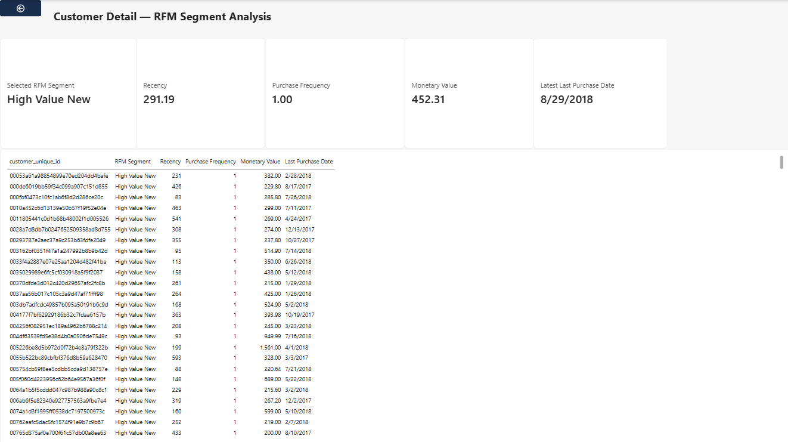

# Olist E-Commerce Sales Analytics: Power BI Dashboard

An interactive Power BI dashboard (4 analysis pages + 2 drill-through pages) built on the Olist Brazilian e-commerce dataset (~99K orders, 2016-2018). It extends my [SQL analysis](https://github.com/thejussahajan/olist-sql-analysis) with a star-schema data model, custom DAX measures and drill-through, and surfaces patterns the SQL output alone did not show.

<!-- Video walkthrough: add link here once uploaded -->



---

## Insights Beyond the SQL Analysis

The SQL work answered *what* the headline numbers are. Building the dashboard exposed patterns underneath them.

### 1. Seller revenue sits in an elite tier, even though no single seller dominates
The top 10 sellers hold only **13.15%** of product revenue, which on its own suggests low concentration. A Pareto view across all 3,095 active sellers shows a different picture:

| Seller tier | Share of revenue |
|---|---|
| Top 1% | 26.07% |
| Top 5% | 53.30% |
| Top 10% | 67.56% |
| Top 20% | 82.69% |
| Bottom 50% | ~3.2% |

**Takeaway:** There is no single-seller dependency risk, but the marketplace relies on a small top tier while half of all sellers contribute almost nothing.

### 2. High-value first-time buyers matter more than loyal customers
Using DAX-based RFM segmentation:
- **High Value New** customers are ~15% of the base (13,861 customers) and generate **47.4%** of revenue.
- **Loyal, Repeat and Champions** segments together are ~3% of customers and ~5.5% of revenue (only 64 Champions).

**Takeaway:** Revenue depends on large first purchases. Converting high-value first-timers into repeat buyers is a stronger retention lever than rewarding the small loyal base.

### 3. Strong YoY growth hides a plateau
Revenue is **+48.9% YoY** (Aug 2018 vs Aug 2017) but **-4.6% MoM**. The monthly trend rose steadily until Nov 2017, then flattened around R$0.85-1.0M. The rolling 3-month average confirms the plateau. The Nov 2017 spike is consistent with Black Friday seasonality.

### 4. Top revenue does not mean top operational quality
The #1 seller (R$229K product revenue, 1,132 orders) has a **10.50% late delivery rate versus 6.77% platform-wide**, and ~88% of its revenue comes from one category (Watches & Gifts). This is only visible by drilling through from the Seller Concentration page.

### 5. Late deliveries hurt reviews, and the map shows where they concentrate
On delivered orders, on-time deliveries average **4.29** review score versus **2.27** for late ones, a **2.02-point gap**. The state-level map shows the heaviest late-delivery shading across Northeast Brazil, and it can be filtered by date, state and category.

---

## Dashboard Pages

| Page | Purpose | Key visuals |
|---|---|---|
| **Executive Summary** | Business health at a glance | KPI cards (Revenue, Orders, AOV, Repeat Rate, MoM %, YoY %), monthly revenue with rolling 3-month average, top categories |
| **Seller Concentration** | How dependent is revenue on a few sellers? | Top 10 sellers, Pareto concentration chart, slicers for date, seller state and category |
| **Delivery & Satisfaction** | Does late delivery hurt satisfaction? | Late rate, review gap (late vs on-time), state map |
| **Customer Segmentation** | Who generates the value? | RFM segments by revenue share and customer count, new vs repeat customers |
| **Customer Detail** *(drill-through)* | Customer-level view per RFM segment | Recency, frequency, monetary value, last purchase date |
| **Seller Detail** *(drill-through)* | One seller's performance | Revenue, orders, AOV, review score, late rate, category breakdown, order list |





### Drill-through pages
Right-click a seller bar on *Seller Concentration* to open **Seller Detail**, or right-click an RFM segment on *Customer Segmentation* to open **Customer Detail**.




---

## Data Model

- **Source:** raw Olist tables (orders, customers, order_items, payments, reviews, sellers, products), not pre-aggregated files.
- **Schema:** star schema with `order_items` as the fact table, surrounded by customer, product, seller and date dimensions, with relationships defined explicitly in Model view.
- **Date table:** a dedicated DAX date table marked as a date table, which enables the time-intelligence measures (MoM, YoY, rolling average).

**Why a star schema instead of a flat table?** Each dimension's attributes live in one place instead of repeating on every order line, filters propagate predictably through single-direction relationships, and the DAX stays simpler and faster.

---

## DAX Measures

| Measure | What it calculates |
|---|---|
| Total Product Revenue | Sum of item prices (excludes freight) |
| Total Orders / AOV | Distinct orders; revenue per order |
| Repeat Purchase Rate % | Customers with more than one delivered order / total customers |
| Revenue MoM % / YoY % | Change vs the prior month / same month last year, using the date table |
| Rolling 3M Avg Revenue | Average monthly revenue over a trailing 3-month window |
| Top 10 Sellers' Revenue Share % | Revenue of the top 10 sellers / total seller revenue |
| Seller Pareto (Top 1/5/10/20/50%) | Cumulative revenue share of the top X% of sellers by rank |
| RFM Segment | Recency, frequency and monetary scoring bucketed with `SWITCH` into Champions, Loyal, Repeat, High Value New and New / Low Value |
| Late Delivery Rate % | Delivered orders arriving after the estimated date / delivered orders |
| Review Gap (Late vs On-Time) | Average review score of late orders minus on-time orders |

---

## Interactivity

- Date range, state and category slicers on every analysis page
- Drill-through from sellers and RFM segments to detail pages
- Cross-filtering between visuals, with KPI cards deliberately isolated where a click would make them misleading
- Insight-led visual titles (for example, "No Single Seller Dominates: Top 10 Hold Only 13.15% of Product Revenue")
- Consistent navy and amber theme, using bar charts instead of pie charts for readability

---

## Metric Scope Note

The repeat purchase rate and customer counts use **delivered orders only** (3.00%, 2,801 of 93,358 customers). Including all order statuses gives 3.12%. Revenue totals (R$13.59M), seller concentration and category shares are calculated on **all order statuses**. The late-delivery rate and the 4.29 vs 2.27 review comparison use delivered orders; the 4.10 average review score card is across all orders.

---

## Repository Contents

```
├── Olist_Retail_Sales_Analytics.pbix   # Power BI file (open in Power BI Desktop)
├── screenshots/                        # Dashboard page images
└── README.md
```

GitHub cannot preview .pbix files. Download the file and open it in [Power BI Desktop](https://powerbi.microsoft.com/desktop/) (free, Windows) to explore the model, DAX and interactions.

## Tools

Power BI Desktop, DAX, Power Query, PostgreSQL (source analysis)

## Author

**Thejus Sahajan**
[LinkedIn](https://linkedin.com/in/thejussahajan/) | [GitHub](https://github.com/thejussahajan)